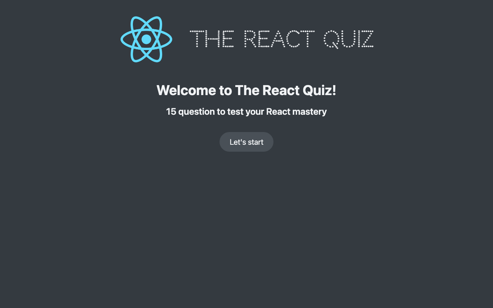

# The React Quiz

React quiz app with a timer, scoring and a progress bar. Built while following a React course on Udemy, so this is learning work and not an original project.



## Features

- 15 questions about React, fetched from a local API
- Score, progress bar and countdown
- Results screen with the option to restart

## What this project demonstrates

- Centralized state with `useReducer`
- Data fetching with loading and error handling
- Splitting the interface into small components

## Running the project

Requires Node 20. Start the API in one terminal and the app in another.

```bash
npm ci
npm run server
```

```bash
npm start
```
